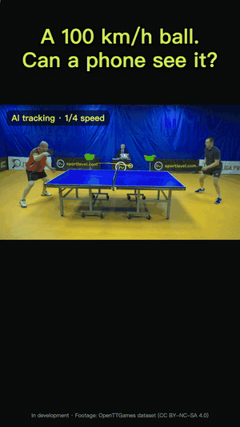

# RallyTrack

An iOS app that analyses table tennis practice videos on the phone. It finds the ball in every
frame, detects bounces and net crossings, splits the video into rallies, and reports ball speed and
where the balls land on the table. Nothing is uploaded: all models run on the device.

<a href="docs/media/rallytrack-demo.mp4"></a>

Full video: [docs/media/rallytrack-demo.mp4](docs/media/rallytrack-demo.mp4) (27 s, no sound).
Footage in the demo is from the OpenTTGames dataset, CC BY-NC-SA 4.0.

This repository holds the app source and the inference work around it:

| Part | What it is |
|---|---|
| `app/` | The SwiftUI app and the analysis pipeline (Core ML on the Apple Neural Engine, vImage pre-processing). |
| `coreml/` | Conversion to Core ML (fp16, and 8-bit from quantization-aware training). |
| `training/` | Model definition, training and quantization-aware fine-tuning scripts. |
| `ggml/` | A port of the ball tracker to [ggml](https://github.com/ggml-org/ggml), with a patch that adds a faster Metal kernel for 3x3 convolution. |
| `coach/` | A session summary written by a local LLM through the [llama.cpp](https://github.com/ggml-org/llama.cpp) C API. |
| `docs/benchmarks.md` | All measurements and how to reproduce them. |
| `docs/media/` | Demo video. |

**No model weights and no training data are in this repository.** The native tools take a weight
file you supply; the app needs the three `.mlpackage` files in `app/RallyTrack/ML/`.

## The model

The ball tracker is a TrackNetV2-style U-Net (`training/tracknet.py`): three consecutive RGB frames
in (9 x 360 x 640), one heatmap out, 18 convolution layers, 2.83 M parameters, about 42 G
multiply-adds per frame. It is small in parameters but heavy in compute, because the first and last
stages run at full resolution. Per-frame cost decides how long the user waits, so most of the work
here is about that number.

## Results

All numbers are per frame at 640 x 360. Details and commands are in [docs/benchmarks.md](docs/benchmarks.md).

**Core ML (what the app ships)**

| Model | Device | Compute unit | Time |
|---|---|---|---|
| fp16 | iPhone 15 Pro Max | Neural Engine | 13.2 ms |
| 8-bit, quantization-aware training | iPhone 15 Pro Max | Neural Engine | 5.66 ms |
| fp16 | Mac, M1 | CPU / GPU / Neural Engine | 58.5 / 36.2 / 10.5 ms |
| 8-bit, quantization-aware training | Mac, M1 | CPU / GPU / Neural Engine | 76.6 / 39.6 / 9.3 ms |

Profiling the whole analysis showed 93% of the time in model inference. The app therefore runs
the model on every other frame of high-frame-rate video and interpolates, and checks only every
fourth frame while no ball has been seen for a while. A 90 s clip went from 78 s to 42 s on an M1 Mac.

**ggml port, M1 GPU (Metal)**

| Convolution path | Time | Graph memory |
|---|---|---|
| ggml direct kernel, as shipped | 2480 ms | 205 MB |
| ggml im2col + matrix multiply | 745 ms | 577 MB |
| **3x3 kernel from this repository, fp32 weights** | **191 ms** | 205 MB |
| **3x3 kernel from this repository, fp16 weights** | **176 ms** | 205 MB |

The new kernel is 13x faster than the direct kernel it replaces and 3.9x faster than the im2col
path, with a third of the memory. Outputs match PyTorch: the largest logit difference on real
frames is 7.6e-05 and the detected ball position is identical.

Core ML on the Neural Engine is still 18x faster than ggml on the GPU for this network, so the app
keeps Core ML. The ggml port is the portable path: the same C++ and the same GGUF file run on any
ggml backend. Only Metal and CPU have been tested here.

## The Metal kernel

ggml's Metal `conv_2d` kernel starts one GPU thread per output value. Each thread walks all input
channels and all nine taps, checks the image bounds on every tap, and reads each input value again
for every output channel.

`ggml/patches/metal-conv2d-3x3.patch` adds `kernel_conv_2d_3x3`, used for 3x3, stride 1, dilation 1:

* One thread computes a 2x2 block of output pixels for four output channels, 16 values.
* Per input channel it loads the 4x4 input patch once (16 reads) and reuses it for all 16 outputs.
  The four output channels are the lanes of a `float4`, so one multiply-add updates four of them.
* Bounds are resolved once per thread, not per tap.

Reads per output value drop from 18 per input channel to about 3.3. The patch is 144 added lines
in four files, against llama.cpp commit `17701e4`. Setting `GGML_METAL_CONV_2D_GENERIC=1` switches
back to the original kernel for comparison.

`ggml/tests/conv2d_3x3_test.cpp` checks the kernel against the CPU backend on random data: odd
sizes, channel counts that are not multiples of four, batches, padding 0 to 3, fp32 and fp16
weights. The largest difference is 8.3e-07.

## The LLM summary

`coach/coach.cpp` loads a GGUF chat model through the llama.cpp C API and writes a two-sentence
summary of a session. The statistics and the advice topic are computed in C++ from the analysis
output. The model only phrases them, with greedy decoding, so the same session always gives the
same text.

With Qwen2.5-1.5B-Instruct at Q4_K_M (0.99 GB) on an M1: 0.2 to 0.7 s to load, about 590 tokens/s
for the prompt, 47 tokens/s for the answer, 2 to 3 s in total.

A 1.5 B model at 4 bits is fluent but not reliable: in testing it sometimes attached a number to
the wrong label. That is why the numbers are printed next to the text and why nothing is left for
the model to decide.

## Build and run

Requirements: macOS on Apple Silicon, CMake, a C++17 compiler, Python 3.10+ with `torch`, `numpy`,
`gguf` and `pillow`.

```sh
# 1. llama.cpp (contains ggml) at the commit the patch was written against, plus the patch
git clone https://github.com/ggml-org/llama.cpp
git -C llama.cpp checkout 17701e4
git -C llama.cpp apply "$PWD/ggml/patches/metal-conv2d-3x3.patch"

# 2. build
cmake -B build -DLLAMA_CPP_DIR="$PWD/llama.cpp"
cmake --build build -j

# 3. kernel correctness: GPU against CPU
./build/conv2d_3x3_test

# 4. export your checkpoint to GGUF (BatchNorm is folded into the convolutions)
python ggml/export_gguf.py ball.pt tracknet-f32.gguf
python ggml/export_gguf.py ball.pt tracknet-f16.gguf --f16

# 5. speed
./build/tracknet -m tracknet-f32.gguf -n 20                                 # Metal, new kernel
GGML_METAL_CONV_2D_GENERIC=1 ./build/tracknet -m tracknet-f32.gguf -n 5     # Metal, original kernel
./build/tracknet -m tracknet-f32.gguf -c im2col -n 20                       # Metal, im2col
./build/tracknet -m tracknet-f32.gguf -b cpu -n 20                          # CPU

# 6. same output as PyTorch, on consecutive video frames (jpg) in a directory
python ggml/parity.py --ckpt ball.pt --gguf tracknet-f32.gguf --bin build/tracknet --frames frames/

# 7. session summary with a local model
./build/coach -m qwen2.5-1.5b-instruct-q4_k_m.gguf -i coach/example/session.json
```

`tracknet` checks that every graph node is supported by the chosen backend before it runs, so a
timing never includes a silent fallback to the CPU.

Core ML conversion:

```sh
python coreml/convert.py ball.pt BallTracker.mlpackage --frames frames/ --bench
python coreml/convert_qat.py traced.pt BallTracker_q8.mlpackage --ref BallTracker.mlpackage --videos clips/
```

## The app

Open `app/RallyTrack.xcodeproj` in Xcode 16 or later (iOS 17 target). Before building, add:

* `app/RallyTrack/ML/BallTracker.mlpackage`, `TableSeg.mlpackage`, `EventNet.mlpackage`
* `app/RallyTrack/Assets.xcassets/ShootingRef.imageset/ref.jpg`, the example picture in the shooting guide

The analysis pipeline is in `app/RallyTrack/Analysis/`:

* `VideoAnalyzer.swift` decodes the video, crops around the table, scales with vImage, runs the ball
  tracker, and decides which frames to skip.
* `Geometry.swift` fits the four table corners and maps image points to table coordinates (homography).
* `Events.swift` turns the ball track into bounces, net crossings, rallies and speeds.
* `app/cli/main.swift` runs the same code from the command line on a Mac and writes the JSON that `coach` reads.

Code comments in the app and the training scripts are in Chinese.
